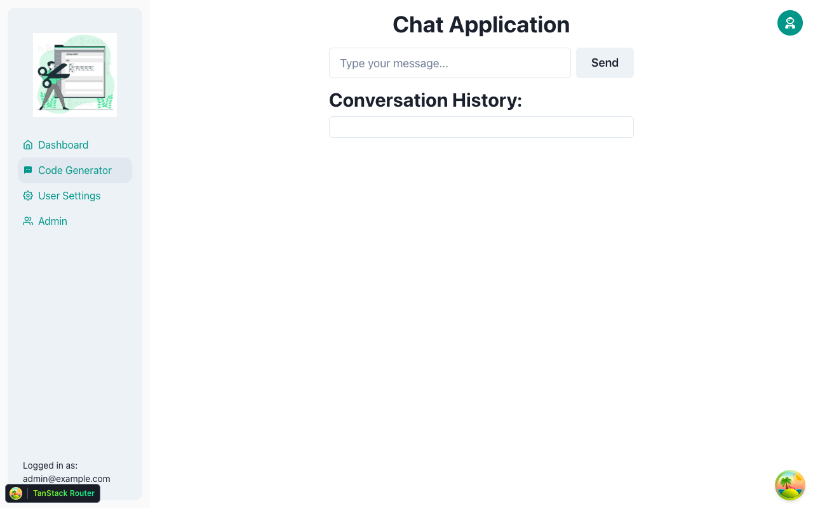
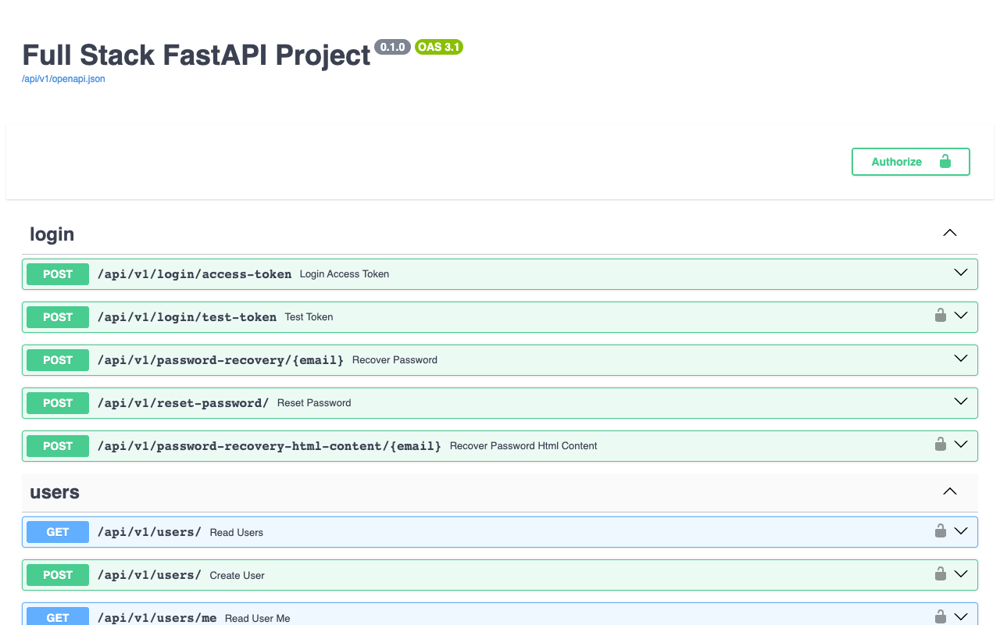

# Code Snippet Generator

A full-stack web app that completes code snippets with a fine-tuned GPT-2 model. It is built on the [Full Stack FastAPI Template](https://github.com/tiangolo/full-stack-fastapi-template): FastAPI + SQLModel + PostgreSQL on the backend, React + TypeScript + Vite + Chakra UI on the frontend, JWT auth, Docker Compose.



*The "Code Generator" page of the running app (frontend dev server + backend + PostgreSQL), captured with Playwright after logging in as the seeded superuser.*



*FastAPI's interactive docs (`/docs`), including the `c_gnr` endpoint.*

## How it works

- `POST /api/v1/c_gnr/` (authenticated) takes `{"input": "<code prefix>"}` and returns the model's completion (max length 100 tokens).
- The fine-tuned checkpoint is **not included in this repository**. Put a Hugging Face GPT-2 checkpoint directory at `backend/app/api/fine_tuned_code_completion_model/` (git-ignored) or point `CODE_MODEL_PATH` at one. Without it the endpoint returns `503`; the rest of the app works normally.
- See `ExtendedAbstract.docx` for the project background.

## Run locally

Requirements: Python 3.10+, Node.js, PostgreSQL (or Docker).

```bash
cp .env.example .env            # then set SECRET_KEY and passwords

# Backend (from backend/)
python -m venv .venv && . .venv/bin/activate
pip install poetry && poetry install   # note: pyproject pins a Linux x86_64 CPU torch wheel
export $(grep -v '^#' ../.env | xargs) PYTHONPATH=.
alembic upgrade head && python app/initial_data.py
uvicorn app.main:app --reload          # http://localhost:8000/docs

# Frontend (from frontend/)
npm ci
VITE_API_URL=http://localhost:8000 npm run dev   # http://localhost:5173
```

Log in with `FIRST_SUPERUSER` / `FIRST_SUPERUSER_PASSWORD` from `.env`. Alternatively run everything with `docker compose up -d --build` (see [development.md](development.md) and [deployment.md](deployment.md)).

## Tests

```bash
cd backend
# the password-recovery test needs SMTP variables set to any value
SMTP_HOST=localhost SMTP_USER=u SMTP_PASSWORD=p EMAILS_FROM_EMAIL=a@example.com pytest
ruff check app
```

CI (`.github/workflows/test.yml`) runs the same suite via Docker Compose on pushes and pull requests to `main`.

## License

See [LICENSE](LICENSE).
